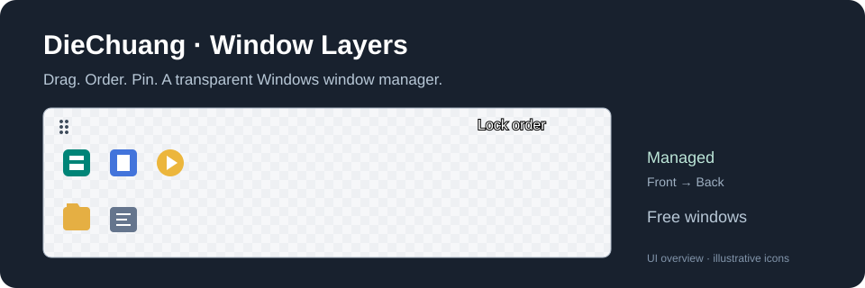

# DieChuang · Window Layers

**A portable Windows window manager for always-on-top, always-on-bottom and custom Z-order.**

[简体中文](README.md) · [MIT License](LICENSE)



Arrange overlapping application windows with a compact transparent two-row icon toolbar. Drag icons to choose which windows stay above or below others, then lock the stacking order.

## Features

- Per-window **Always on Top**, **Normal**, and **Always on Bottom** modes.
- Drag-and-drop window ordering: left to right means front to back within each band.
- Move icons between the managed upper row and unmanaged lower row.
- Native application icons with smooth per-pixel alpha transparency and a rounded frame.
- Manage the toolbar itself as a window; recover it with a global shortcut.
- Named local profiles, system tray controls and keyboard navigation.
- Offline operation using documented Win32 APIs; no process injection or window-content collection.
- C#, Windows Forms and .NET Framework source included.

## Run

Download and extract a portable ZIP from **Releases**, then run `WindowLayers.exe`. If no release is available, build from source as below. Drag icons into the upper row and click the lock button. Right-click a managed icon to choose its layer.

| Shortcut | Action |
| --- | --- |
| `Ctrl + Alt + F10` | Toggle order locking |
| `Ctrl + Alt + F11` | Reveal and pin the toolbar |
| `Ctrl + Up / Down` | Move a focused icon between rows |
| `Ctrl + Left / Right` | Reorder a focused managed icon |
| `Shift + F10` | Open the icon menu |

The current interface labels are Chinese. Closing the toolbar hides it to the tray; use the tray menu to exit and restore original topmost flags.

## Build on Windows

Windows 10 / 11 with .NET Framework 4.x:

```powershell
powershell -NoProfile -ExecutionPolicy Bypass -File .\source\build.ps1
```

No .NET SDK, Python or AutoHotkey installation is required. The output is `WindowLayers.exe` in the repository root.

To run integration checks on an interactive Windows desktop:

```powershell
$p = Start-Process .\WindowLayers.exe -ArgumentList '--self-test test-results.txt' -PassThru -Wait
Get-Content .\test-results.txt
$p.ExitCode
```

## Limitations and privacy

Exclusive fullscreen games, secure desktops, elevated applications and programs enforcing their own Z-order may behave differently. Profiles use exact process/class/title matching; changed or ambiguous titles can require manual re-adding. Profiles load unlocked. Minimized windows are not automatically restored.

`profiles.xml` contains local window titles and is ignored by Git. Do not publish your personal configuration or unredacted desktop captures. The project ships no user-specific profiles. A forced process termination may leave topmost flags in place; restart the affected application or reapply normal mode.

## Discoverability

Related terms: **Windows window manager, always on top utility, always on bottom, window stacking order, Z-order control, transparent floating toolbar, drag and drop, portable desktop utility, WinForms, C#, Windows productivity**.

Chinese name: **叠窗**. Chinese queries: **窗口置顶、窗口置底、窗口层级管理、多窗口排序、透明悬浮工具栏**.

## License and contributions

MIT. Maintained by `winfater8-hash`. See [CONTRIBUTING.md](CONTRIBUTING.md) for issue and pull-request guidance.
