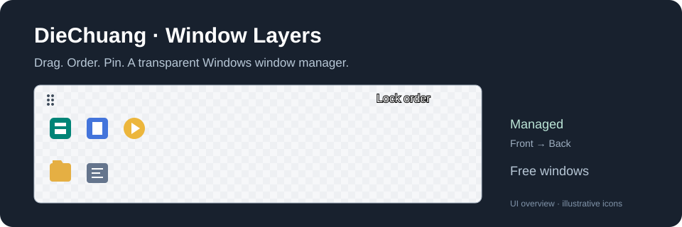

# 叠窗 DieChuang · Window Layers

**Windows 窗口置顶、置底与多窗口层级排序工具。** 用一个透明双排图标栏，拖动管理窗口的前后遮挡顺序。

[English](README.en.md) · [使用说明](docs/USAGE.zh-CN.md) · [MIT License](LICENSE)



叠窗是一个免费、免安装的 Windows 桌面小工具。它支持 **Always on Top / Always on Bottom / Z-order**：把参考资料留在前面，把不常用的窗口放到底层，并锁定多个窗口的显示顺序。

## 功能

- **窗口置顶 / 窗口置底**：每个窗口单独选择置顶、普通或置底。
- **拖拽排序**：上排从左到右对应从前到后；拖到下排可停止管理。
- **透明悬浮工具栏**：原生应用图标、逐像素透明、平滑边缘、小圆角细边框。
- **工具栏自身可置顶**：叠窗也作为图标参与排序。
- **快捷键与托盘**：暂停、恢复、唤出工具栏；关闭界面后可留在系统托盘。
- **保存多套方案**：按应用、窗口类和标题匹配已打开窗口。
- **本地运行**：不联网，不注入其他进程，不读取窗口正文。
- **C# / WinForms / Win32**：附完整源码和本地重建脚本。

## 快速开始

1. 从仓库的 **Releases** 下载便携 ZIP，解压到固定文件夹；若还没有发行版，请按下方说明编译。
2. 双击 `WindowLayers.exe`。
3. 把下排的程序图标拖到上排，左右拖动调整顺序。
4. 点击 **开始锁定**；右键图标可选置顶、普通或置底。
5. 拖动左上角点阵可移动整个工具栏；右上角 `⋯` 菜单可保存方案、隐藏或退出。

| 操作 | 快捷键 |
| --- | --- |
| 开始 / 解除锁定 | `Ctrl + Alt + F10` |
| 唤出工具栏并将自身置顶 | `Ctrl + Alt + F11` |
| 图标移到上排 / 下排 | 聚焦图标后 `Ctrl + ↑ / ↓` |
| 调整上排顺序 | 聚焦图标后 `Ctrl + ← / →` |
| 图标菜单 | `Shift + F10` |

## 从源码编译

适用于 Windows 10 / 11。需要 Windows 自带的 .NET Framework 4.x 环境；无需 Python、AutoHotkey 或 .NET SDK。

```powershell
powershell -NoProfile -ExecutionPolicy Bypass -File .\source\build.ps1
```

输出为仓库根目录的 `WindowLayers.exe`。重新编译前请从托盘退出旧实例。

自检会创建并关闭临时测试窗口，建议在有交互式桌面的 Windows 会话运行：

```powershell
$p = Start-Process .\WindowLayers.exe -ArgumentList '--self-test test-results.txt' -PassThru -Wait
Get-Content .\test-results.txt
$p.ExitCode
```

## 行为说明

置顶组高于普通窗口，置底组低于其他可见普通窗口；每组内部按上排图标顺序排列。普通模式只固定受管普通窗口彼此的顺序。拖入已有分组时会继承落点的模式。

启动或加载方案后默认未锁定。最小化窗口不会被自动还原；真实模态对话框只暂停所属父窗口。置顶只是视觉层级，键盘输入仍交给你激活的窗口。

方案保存在程序旁边的 `profiles.xml`，会包含窗口标题，请不要把个人配置提交到公开仓库。仓库不附带任何个人方案或桌面截图。

## 已知限制

- 独占全屏游戏、安全桌面、强制控制层级的应用不保证兼容。
- 管理高权限应用时可能需要使用相同权限运行本工具。
- 窗口标题发生变化或存在多个完全相同标题时，方案可能无法唯一匹配，需要重新添加。
- 正常退出会恢复原来的置顶标记；强制结束进程时可能来不及恢复。
- 工具栏采用独立透明显示层，视觉变化通常在下一个刷新周期生效。

## 你可能正在寻找

窗口置顶工具、窗口置底工具、多窗口排序、固定窗口遮挡顺序、窗口层级管理、透明桌面工具栏、悬浮图标栏、拖动窗口优先级、Windows 10 / Windows 11 桌面效率工具。

English search terms: **Windows window manager, always on top, always on bottom, Z-order manager, window stacking order, transparent toolbar, drag-and-drop window ordering, portable desktop utility**.

这些词描述的是项目真实功能；搜索收录和排名由平台决定。

## 反馈与贡献

欢迎在 Issues 提交问题。请说明 Windows 版本、目标应用、窗口模式、复现步骤与期望效果；截图前请遮挡个人信息。

详见 [CONTRIBUTING](CONTRIBUTING.md)。本项目以 [MIT](LICENSE) 协议开源，由 `winfater8-hash` 维护。
